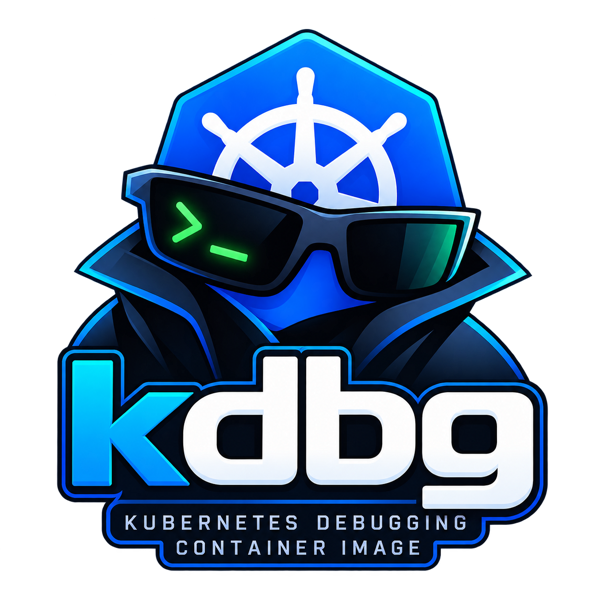

<p align="center">
  
</p>

<p align="center">
  <b><i>A small container image for debugging Kubernetes clusters from the inside.</i></b>
</p>

When something in a cluster can't reach something else (a service won't
resolve, a port won't answer, traffic is slow), you need a shell next to the
problem with the right tools in it. Application images rarely ship those tools.
kdbg is an Alpine image with common network troubleshooting tools and `kubectl`
already installed, so you can run it in the cluster and start investigating.

## What's inside

| Tool | What it gives you | Why it helps in a cluster |
| --- | --- | --- |
| `bash` | A comfortable shell | Tab completion and history while you poke around. |
| `curl`, `wget` | HTTP requests | Check whether a service answers and what it returns. |
| `dig`, `nslookup`, `host` | DNS lookups | Check that service names resolve, and to which IPs. Many "can't connect" problems are really DNS problems. |
| `ping` | Basic reachability | Quick first check that another pod or node can be reached. |
| `mtr`, `tcptraceroute` | Network path tracing | Find where along the way traffic to a host gets lost or slows down. |
| `nc` (netcat), `socat` | Raw TCP/UDP connections | Test whether a port is open, or relay traffic between ports. |
| `telnet` and other busybox extras | Manual protocol checks | Type commands at a service by hand. |
| `iptraf-ng` | Live traffic monitor | Watch which connections are active on an interface. |
| `tcpdump` | Packet capture | See whether traffic actually reaches a pod, and what it looks like. |
| `ip`, `ss` | Network setup and sockets | `ip addr` and `ip route` show the pod's network setup. `ss -tlnp` lists open ports and connections. |
| `openssl` | TLS inspection | `openssl s_client` shows a server's certificates, their expiry and chain, and which hostname is presented. Useful for ingress and webhook certificate problems. |
| `jq`, `yq` | JSON and YAML filtering | Pick out fields from `kubectl ... -o json` output and API responses. |
| `iperf3` | Bandwidth testing | Run it in two kdbg pods to measure network speed between them, for example across nodes. |
| `nmap` | Port scanning | Find what's listening across a range of pods or services, and check that network policies block what they should. |
| `strace`, `lsof` | System calls and open files | With `kubectl debug --target`, see what another container's process is doing and which files and sockets it has open. |
| `ps`, `top` (procps) | Full process tools | More detailed process information than the busybox versions. |
| `conntrack`, `iptables`, `nft` | Connection tracking and firewall rules | When debugging a node, see how kube-proxy routes service traffic and which connections it is tracking. |
| `kubectl` | The Kubernetes API | Query the cluster from inside it, as the pod's service account. |

Images are built for `linux/amd64` and `linux/arm64`.

## Usage

The image is published at `ghcr.io/raqqun/kdbg`.

### Start a throwaway debug pod

```sh
kubectl run kdbg -it --rm --restart=Never --image=ghcr.io/raqqun/kdbg -- bash
```

You get a shell in a new pod, in the same network as your workloads. The pod is
deleted when you exit.

Add `-n <namespace>` to start it in a specific namespace. This matters when
you're testing short DNS names like `my-service`, or network policies.

### Attach to a running pod

To debug a specific pod, add kdbg to it as an ephemeral container. It shares
the pod's network, so `localhost` is the pod's own `localhost`:

```sh
kubectl debug -it <pod> --image=ghcr.io/raqqun/kdbg --target=<container> -- bash
```

`--target` also lets you see the target container's processes.

### Debug a node

```sh
kubectl debug node/<node> -it --image=ghcr.io/raqqun/kdbg -- bash
```

This runs kdbg on the node with the host's network. The node's filesystem is
mounted at `/host`.

### Run it locally

```sh
podman run --rm -it ghcr.io/raqqun/kdbg bash
# or
docker run --rm -it ghcr.io/raqqun/kdbg bash
```

### Things to know

- **`kubectl` inside the pod** uses the pod's service account. It can only do
  what that account is allowed to do, which by default is very little.
- **Some tools need extra privileges.** `tcpdump` and `iptraf-ng`, and `ping` or
  `mtr` on some clusters, need the `NET_RAW` or `NET_ADMIN` capabilities. If they fail with a
  permission error, the cluster's security policy is probably blocking them.
- **Node tools only make sense on a node.** `conntrack`, `iptables` and `nft`
  show the network rules of wherever kdbg is running. Inside a normal pod that
  is the pod's own, mostly empty, network. Use them with
  `kubectl debug node/<node>` to see the node's rules. They also need the
  `NET_ADMIN` capability.

## Image tags

Image versions follow `kubectl` versions. There is one image for each of the
three newest Kubernetes minor versions, so you can pick the one that matches
your cluster. `kubectl` is only guaranteed to work with clusters within one
minor version of itself.

| Tag | What it is | Example |
| --- | --- | --- |
| `<major>.<minor>` | The latest patch release of that minor version | `1.36` |
| `<major>.<minor>.<patch>` | That exact `kubectl` version | `1.36.5` |
| `latest` | The newest supported minor version | Same as `1.37` |

Images are rebuilt every week and on every change to this repository. New
`kubectl` patch releases and Alpine security updates are picked up
automatically. When a new Kubernetes minor version is released, it is added and
the oldest one stops being rebuilt. Its existing tags stay available but no
longer get updates.

Use an exact `<major>.<minor>.<patch>` tag if you need the `kubectl` version to
stay fixed. The image is still rebuilt weekly, so the Alpine packages in it can
change.

## Building it yourself

```sh
podman build -t kdbg .
```

To use a different `kubectl` version:

```sh
podman build --build-arg KUBECTL_VERSION=1.36.5 -t kdbg .
```

## License

MIT. See [LICENSE](LICENSE).
